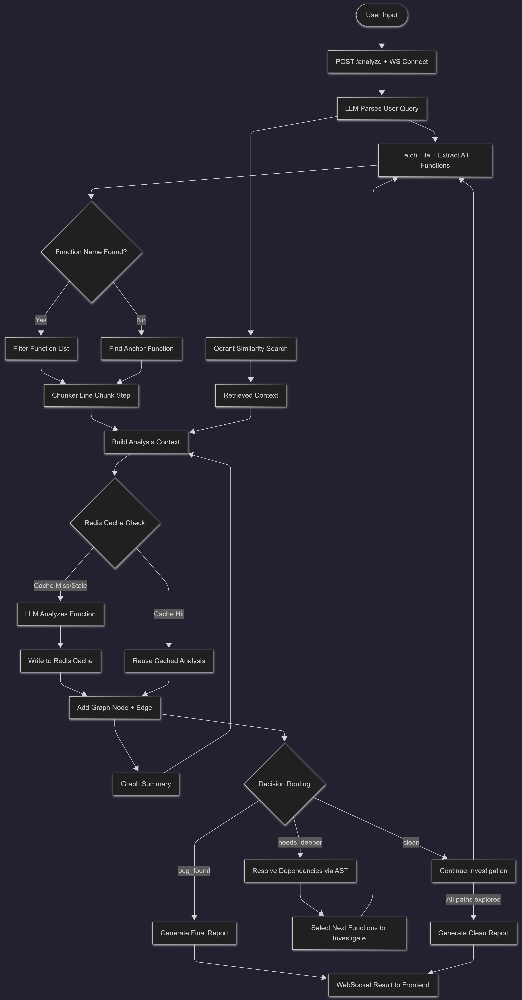

# CodeAssist

> AI-powered repository-aware debugging and compiler static analysis system that analyzes dependency relationships, control flow, and data flow across files instead of isolated code snippets.


---

## 1. What is CodeAssist?

CodeAssist is an autonomous, repository-aware code analysis and debugging platform. Given a GitHub repository, a source file path, an optional error log, and a plain-English query, it traces actual dependency chains, constructs compiler intermediate representations, and produces a structured root-cause diagnostic report.

### Key Capabilities
- **Cross-File Dependency Graph**: An AST-based engine constructs a function-call graph across repository files so the LLM reasons with context accumulated across every investigated path, rather than analyzing functions in isolation.
- **Multi-Language Support (Python, C, C++)**: Decoupled language adapters parse Python using native `ast` and C/C++ using `tree-sitter`, normalizing functions, spans, parameters, and call expressions into a unified abstraction.
- **Compiler Control Flow Graph (CFG) Engine**: Decomposes functions into maximal straight-line `BasicBlock` sequences connected by typed `CFGEdge` objects (branches, loops, jumps, exceptions, switch-cases), flagging unreachable blocks.
- **Static Data-Flow & SSA Analysis**: Built on a generic monotonic `WorklistSolver`:
  - **Liveness Analysis**: Detects dead stores and uninitialized variables via backward data-flow.
  - **Reaching Definitions**: Tracks definition sites to build fine-grained def-use chains.
  - **Dominator Tree & SSA $\phi$-Placement**: Computes immediate dominators ($\text{idom}$), dominance frontiers ($DF$), and Cytron iterated dominance frontier ($IDF$) $\phi$-node placements.
- **Error-Log-Guided Diagnostics & Backward Slicing**: Parses Python tracebacks and GCC/Clang diagnostics, anchors directly to the failing function, and computes a minimal backward slice (data dependencies via def-use chains + control dependencies from enclosing `if`/`while`/`for`/`switch` blocks).
- **Dual-Path Retrieval & Semantic Memory**: CodeBERT embeddings resolve traversal entry points while Qdrant retrieves top-$k$ similar bug patterns from the knowledge base.
- **AST-Hash Caching**: Redis caches LLM analyses keyed by structural AST hashes. Functions that haven't changed across branches or repeated runs are retrieved with zero latency and zero LLM cost.
- **Real-Time Observability**: Traversal logs, cache hits/misses, and routing decisions stream live over WebSockets, visualized on the frontend with interactive **ReactFlow** dependency graphs.

---

## 2. Tech Stack

| Layer | Technology | Purpose |
| :--- | :--- | :--- |
| **Frontend** | React, TypeScript, Vite, Tailwind | Responsive chat and analysis interface |
| **Graph Visualization** | ReactFlow | Interactive, color-coded node-link dependency graphs |
| **Backend API** | FastAPI, Python 3.12, Uvicorn | Asynchronous REST and WebSocket server |
| **Real-Time Streaming** | WebSockets | Live status spinners, traversal logs, and final payloads |
| **AST & Multi-Language** | Python `ast`, Tree-Sitter (`tree-sitter-c`, `tree-sitter-cpp`) | Normalized function extraction and call-graph resolution |
| **Compiler Analysis** | Custom CFG Engine, Fixed-Point Worklist Solver | Basic blocks, liveness, def-use chains, dominators, SSA $\phi$-nodes |
| **Fault Localization** | Diagnostics Regex Parsers, Backward Slicer | Stack trace / compiler log parsing and backward program slicing |
| **LLM Reasoning** | Gemini 2.5 Flash | Query intent classification, node navigation decisions, report synthesis |
| **Embeddings** | CodeBERT (`microsoft/codebert-base`) | 768-dimensional semantic code and query embedding |
| **Vector Database** | Qdrant Cloud | Top-$k$ semantic bug pattern retrieval |
| **Cache** | Upstash Redis | AST-hash-keyed node analysis caching |
| **Testing** | Pytest | 25 automated unit and integration tests |

---

## 3. Architecture & Flow Diagram

```mermaid
flowchart LR
    A[User Inputs: Repo, File, Query, Error Log] --> B[FastAPI /analyze]
    B --> C[WebSocket /ws/job_id]
    C --> D[GitHub Source Fetch & AST Parsing]
    D --> E{Error Log Provided?}
    E -->|Yes| F[Diagnostics Parser & Backward Slicer]
    E -->|No| G[LLM Intent & CodeBERT Semantic Anchor]
    F --> H[Anchor Function]
    G --> H
    H --> I[Qdrant Semantic Retrieval]
    I --> J[DecisionRouter BFS Traversal]
    J --> K{Redis AST Hash Cache?}
    K -->|Hit| L[Cached Decision]
    K -->|Miss| M[LLM Analysis & Static Findings]
    M --> N[Store in Redis]
    L --> O[Update Graph & Follow Calls]
    N --> O
    O --> P[Final Markdown Report + ReactFlow Graph]
```





---

## 4. API Endpoints

| Method | Endpoint | Description |
| :--- | :--- | :--- |
| `POST` | `/analyze` | Submit analysis request and register job |
| `WS` | `/ws/{job_id}` | Real-time streamed analysis, logs, and final results |
| `GET` | `/health` | System health check (Redis, Qdrant, CodeBERT, LLM) |
| `GET` | `/cache/stats` | Redis cache statistics (number of cached nodes) |
| `POST` | `/cache/clear` | Flush all cached analysis nodes in Redis |

### WebSocket Protocol

Messages streamed over `/ws/{job_id}`:

```json
// Progress spinner
{ "type": "spinner", "message": "Understanding your query..." }

// Real-time traversal log
{ "type": "log", "message": "🔍 Analyzing `compute_average` in `math_utils.py` (depth 0)" }

// Final result
{
  "type": "result",
  "data": {
    "status": "bug_found",
    "report": "## Bug Analysis\n...",
    "graph": { "nodes": [], "total": 3 },
    "mermaid": "graph TD\n...",
    "found_in": { "function": "compute_average", "file": "math_utils.py" }
  }
}

// Error notification
{ "type": "error", "detail": "Repository fetch failed: 404 Not Found" }
```

---

## 5. Getting Started

### Prerequisites
- Python 3.12+
- Node.js 18+
- Docker (optional)
- Gemini API key
- Qdrant Cloud account
- Upstash Redis account

---

### Backend Setup

```bash
cd backend

# Create virtual environment
python -m venv venv

# Windows
venv\Scripts\activate

# Linux / macOS
source venv/bin/activate

# Install dependencies
pip install -r requirements.txt
```

Create a `.env` file inside `backend/`:

```env
GEMINI_API_KEY=your_gemini_api_key

QDRANT_URL=your_qdrant_url
QDRANT_API_KEY=your_qdrant_api_key

REDIS_HOST=your_redis_host
REDIS_PORT=6379
REDIS_PASSWORD=your_redis_password
REDIS_SSL=true

MAX_DEPTH=5
TOP_K=3
```

Run the backend server:

```bash
uvicorn app.main:app --reload --port 8000
```

---

### Frontend Setup

```bash
cd frontend

npm install
npm run dev
```

Create a `.env` file inside `frontend/`:

```env
VITE_API_BASE=http://localhost:8000
```

The frontend will run at `http://localhost:5173`.

---

### Running the Test Suite

CodeAssist includes 25 unit and integration tests covering multi-language adapters, CFG construction, static analysis (liveness, reaching definitions, dominators, SSA $\phi$-placement), diagnostics log parsing, and backward slicing:

```bash
# From repository root
pytest backend/tests -v
```

---

### Docker Deployment

```bash
cd backend

docker build -t codeassist_backend .

docker run -p 8000:8000 \
  -e GEMINI_API_KEY=your_key \
  -e QDRANT_URL=your_url \
  -e QDRANT_API_KEY=your_key \
  -e REDIS_HOST=your_host \
  -e REDIS_PORT=6379 \
  -e REDIS_PASSWORD=your_password \
  codeassist_backend
```

---

## 6. Project Structure

```text
CodeAssist/
├── backend/
│   ├── app/
│   │   └── main.py              # FastAPI app, WebSocket handler, job store
│   ├── New_Model/
│   │   ├── adapters/            # Multi-language adapters (Python ast, C/C++ tree-sitter)
│   │   ├── cfg/                 # Control Flow Graph & basic block builders
│   │   ├── static_analysis/     # Worklist solver, liveness, def-use, SSA phi placement
│   │   ├── diagnostics/         # Error log parser & backward program slicer
│   │   ├── ast_engine.py        # GitHub source fetcher & symbol resolution
│   │   ├── router.py            # Autonomous BFS DecisionRouter
│   │   ├── llm_analyzer.py      # Gemini 2.5 Flash query parser & diagnostic reporter
│   │   ├── embedder.py          # CodeBERT embedder & Qdrant retriever
│   │   └── redis_cache.py       # AST-hash staleness validation & Redis cache
│   └── tests/                   # 25 automated unit & integration tests
├── frontend/
│   └── src/
│       ├── App.tsx              # Root component
│       ├── ChatLayout.tsx       # Main chat, WebSocket stream, ReactFlow graph
│       └── Sidebar.tsx          # System health monitor & traversal depth settings
└── README.md
```

---

## 7. Roadmap

- [x] Multi-language support for C and C++ via Tree-Sitter
- [x] Control Flow Graph (CFG) generation with basic block dead code detection
- [x] Data-flow analysis (Liveness, Def-Use chains, Dominators, SSA $\phi$-placement)
- [x] Compiler / runtime error-log-guided diagnostics and backward program slicing
- [ ] Multi-root-cause detection across independent dependency paths
- [ ] Additional language adapters (Rust, Go, Java)
- [ ] Confidence-based branch pruning and early stopping during traversal
- [ ] Redis job-ID storage migration from in-memory to TTL-based Redis keys

---

## Author

**B Sri Ram**
